<a href="https://kohar.space">
  <picture>
    <source media="(prefers-color-scheme: dark)" srcset="assets/header-dark.svg">
    
  </picture>
</a>

  
  
  

I build software for real businesses, and I like knowing how every part of it works. I lead the engineering team behind **SortMe**, a personal-finance product, at [Atas.AI](https://atas.ai/). I also run **[Eyzet](https://eyzet.io/)**, my own SaaS that helps internet providers manage their networks and customers.

AI is part of how I work now. It helps me ship faster. Understanding the problem, questioning the solution, and owning what ships is still my job.

### Right now

- **Leading** the SortMe engineering team at Atas.AI: product code, automation, and CI.
- **Building** [Eyzet](https://eyzet.io/), an ISP-management SaaS with MikroTik and FreeRADIUS integration.
- **Writing** a developer diary at [kohar.space](https://kohar.space/blog/) about lessons from real projects.
- **Exploring** AI agents in everyday dev work, for example [paseo-task-viewer](https://github.com/akoharu/paseo-task-viewer).

### Selected work

<table>
  <tr>
    <td width="50%" valign="top">
      <b><a href="https://kohar.space/projects/sortme/">SortMe</a></b> 
      Engineering team lead · Atas.AI 
      Personal-finance product. I lead the team and work across the code, automation, and continuous integration.
    </td>
    <td width="50%" valign="top">
      <b><a href="https://kohar.space/projects/eyzet/">Eyzet</a></b> 
      Founder & full-stack developer 
      SaaS that helps internet providers run their daily operations, from customers to network devices.
    </td>
  </tr>
  <tr>
    <td width="50%" valign="top">
      <b><a href="https://kohar.space/projects/sibudak/">SIBUDAK</a></b> 
      Public health · Bogor Regency 
      Immunization-records application for the Bogor Regency Public Health Office.
    </td>
    <td width="50%" valign="top">
      <b><a href="https://kohar.space/projects/automatic-door-access/">Automatic Door Access</a></b> 
      Computer vision · Raspberry Pi 
      A door that opens with face recognition and checks for a face mask.
    </td>
  </tr>
</table>

More projects and the story behind them: <a href="https://kohar.space/projects/">kohar.space/projects</a>

### Tools I use most

<picture>
  <source media="(prefers-color-scheme: dark)" srcset="https://skillicons.dev/icons?i=js%2Cts%2Cphp%2Cpy%2Creact%2Cvue%2Cangular%2Cnodejs%2Cexpress%2Claravel%2Cflask&theme=dark&perline=11">
  
</picture>
 
<picture>
  <source media="(prefers-color-scheme: dark)" srcset="https://skillicons.dev/icons?i=mysql%2Cmongodb%2Cdocker%2Ckubernetes%2Caws%2Cgit%2Cvscode&theme=dark&perline=11">
  
</picture>

### From the diary

- [How to fork an open source project ethically when AI writes most of your code](https://kohar.space/blog/forking-open-source-ethically-in-the-vibe-coding-era/) · Oct 2026
- [Tracing and blocking webshell scanners with Cloudflare analytics and WAF rules](https://kohar.space/blog/tracing-and-blocking-webshell-scanners-with-cloudflare/) · Oct 2026
- [Function calling: connecting AI to your application](https://kohar.space/blog/function-calling/) · Sep 2024
- [How to collect MikroTik HTTP logs for a web dashboard](https://kohar.space/blog/mikrotik-http-logs/) · Feb 2022

Open to conversations about product engineering, SaaS, and AI-assisted development. Say hello at <a href="mailto:hallo@kohar.space">hallo@kohar.space</a>.
